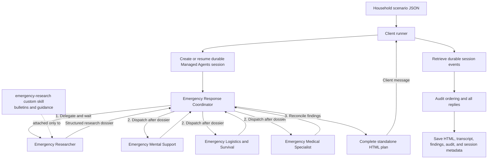

# Emergency Handling Architecture

This demo uses Anthropic Managed Agents to turn one fictional household
emergency scenario into a single printable HTML preparedness plan. The client
runner validates the input, creates or resumes a durable session, and sends the
scenario to the **Emergency Response Coordinator**. The coordinator enforces a
research-first dependency: it delegates to the **Emergency Researcher**, which
is the only agent attached to the custom `emergency-research` skill. After the
research dossier is returned, the coordinator dispatches the **Mental Support**,
**Logistics and Survival**, and **Medical** specialists with the same household
context and dossier, preferably in parallel.

The coordinator reconciles the specialist replies and returns the complete HTML
document in its client message. The runner retrieves durable session events,
checks that every specialist was delegated to and replied in the required
order, and atomically saves the report and diagnostic outputs. The research and
household data are fictional demo inputs; the system is not a live emergency or
clinical service.

## Responsibilities

- **Coordinator:** owns delegation, dependency ordering, reconciliation, and
  final HTML generation.
- **Researcher:** matches the incident to supplied fictional bulletins and
  general guidance, preserving source IDs and unknowns.
- **Specialists:** provide focused mental-support, practical logistics, and
  medical-preparedness findings without creating files or duplicate reports.
- **Client runner:** owns session lifecycle, event collection, workflow audit,
  recovery by session ID, and local output persistence.